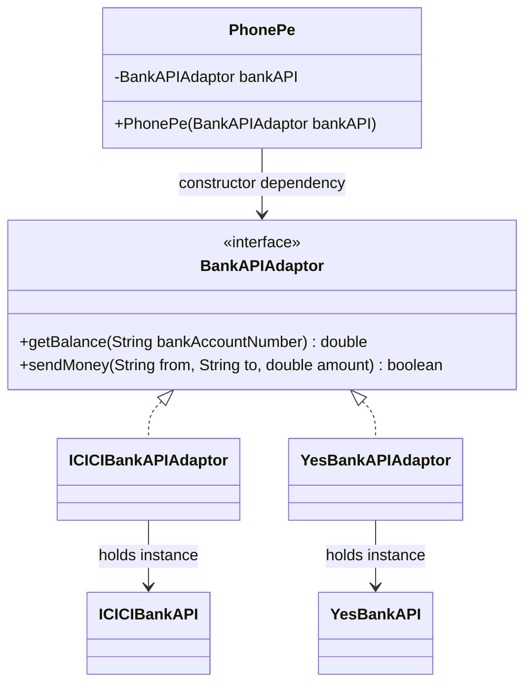

# Adapter Design Pattern — A Shared Bank Integration Contract in Java

### Keep the client dependent on an interface while isolating provider-specific integration points

A focused **Java object-oriented design scaffold** that models a payment-app client depending on a common bank interface. Separate ICICI and Yes Bank adapter classes implement that interface and hold references to their corresponding provider classes.

The example demonstrates the structure of an adapter boundary and **constructor-based dependency injection**. Provider behavior is intentionally incomplete in the current code: the bank classes are empty, and both adapters return fixed placeholder values.

[Source on `master`](https://github.com/FaiazS/Adaptor-Design-Pattern/tree/master/src/main/java/AdaptorDesignPattern/ThirdPartyIntegrationAdaptor) · [Shared interface](https://github.com/FaiazS/Adaptor-Design-Pattern/blob/master/src/main/java/AdaptorDesignPattern/ThirdPartyIntegrationAdaptor/BankAPIAdaptor.java) · [Client](https://github.com/FaiazS/Adaptor-Design-Pattern/blob/master/src/main/java/AdaptorDesignPattern/ThirdPartyIntegrationAdaptor/PhonePe.java)

> **Branch guide:** The default `main` branch contains documentation only. Java source and `pom.xml` are on **`master`**. This is a design exercise, with no real bank connection, account lookup, or money transfer.

---

## The integration problem

A client that directly depends on every bank's concrete API becomes coupled to provider-specific classes and methods. A shared application-facing interface creates a boundary where provider differences can be translated.

This project expresses that boundary through `BankAPIAdaptor`:

```java
double getBalance(String bankAccountNumber);
boolean sendMoney(String from, String to, double amount);
```

The `PhonePe` class receives an implementation of that interface through its constructor. It does not instantiate an ICICI or Yes Bank implementation itself.

Bank and payment-app names are illustrative class names. The repository does not contain official provider SDK integrations or evidence of affiliation.

## Practical value of the design

| Design requirement | What the source demonstrates |
|---|---|
| Keep the client independent of a concrete bank class | Client field and constructor use `BankAPIAdaptor` |
| Give providers a consistent application-facing contract | Two adapters implement the same methods |
| Isolate provider-specific integration work | Each adapter holds its corresponding provider object |
| Select an integration at the composition boundary | Caller supplies the adapter when constructing the client |
| Create a future substitution point for tests | Interface can support a fake implementation |

The last point is a capability of the design, not an implemented test suite. Reduced integration effort, reliability, and financial or operational impact have not been measured.

## Architecture



The composition structure resembles an object adapter: an adapter implements the target interface and contains a provider object. **Actual translation and delegation are not implemented**, because the provider classes expose no methods and the adapters never call them.

## Class responsibilities

| Type | Current implementation |
|---|---|
| `BankAPIAdaptor` | Declares balance lookup and transfer methods |
| `ICICIBankAPIAdaptor` | Implements the interface; returns `0` for balance and `false` for transfer |
| `YesBankAPIAdaptor` | Implements the interface; returns `0` for balance and `false` for transfer |
| `ICICIBankAPI` | Empty provider placeholder |
| `YesBankAPI` | Empty provider placeholder |
| `PhonePe` | Receives an adapter and contains one illustrative balance-based method |
| `com.scaler.Main` | Prints `Hello, World!` |

## Constructor injection in the client

The key dependency boundary is visible in the constructor:

```java
public PhonePe(BankAPIAdaptor bankAPI) {
    this.bankAPI = bankAPI;
}
```

A caller can construct the client with either implementation:

```java
PhonePe iciciClient = new PhonePe(new ICICIBankAPIAdaptor());
PhonePe yesBankClient = new PhonePe(new YesBankAPIAdaptor());
```

This is illustrative wiring using the existing API, not code present in the committed `Main`. It requires importing the classes from `AdaptorDesignPattern.ThirdPartyIntegrationAdaptor` when used outside that package.

Adding another provider would require its implementation and caller-side wiring. The client can continue using the same interface as long as the new provider's behavior can satisfy that contract.

## What the client method actually does

`PhonePe.doSomething()`:

1. Calls `getBalance("Bank Account Number")` using a literal placeholder account identifier.
2. Sleeps for `24 * 24 * 60 * 60 * 1000` milliseconds.
3. Returns the retrieved value multiplied by two.

The sleep expression is **2,073,600,000 milliseconds, or 24 days**. It is not a short demonstration delay. Do not invoke this method expecting an immediate result from the unchanged source.

The method has package-level visibility and declares `InterruptedException`. With the current adapter stubs, it would eventually return `0.0` after the sleep if not interrupted. That is inferred from source, not an observed execution result. Multiplying a placeholder balance is illustrative client logic, not a financial calculation or interest model.

There is no committed runner that calls this method, compares the two adapters, or prints bank-specific results. The existing README's example bank-result output is not produced by `Main` as committed.

## Current contract considerations

- **No provider calls:** Adapter fields hold provider instances, but those objects are unused.
- **No transfer implementation:** `sendMoney` always returns `false`; no funds move.
- **Parameter-name mismatch:** The interface declares `(from, to, amount)`, while the ICICI implementation names its first two parameters `(to, from, amount)`. Java accepts this because the types match, but it is a semantic risk when implementing the method later.
- **Money representation:** The interface uses `double`, with no currency, precision, or rounding policy. A real monetary contract would need an explicit representation and rules.
- **Limited error contract:** A numeric balance and Boolean transfer result do not distinguish provider failure, validation failure, rejection, or success details.
- **No validation:** Account identifiers, amounts, and injected dependencies are not checked.
- **No verification evidence:** No automated tests, real API responses, or saved execution results are committed in the reviewed source layout.

## Build and inspect

The Maven configuration targets **Java 23** and declares no external dependencies.

```bash
git clone --branch master https://github.com/FaiazS/Adaptor-Design-Pattern.git
cd Adaptor-Design-Pattern
mvn compile
```

Use JDK 23 to match the committed compiler settings, with Maven installed. The existing entry point is:

```bash
java -cp target/classes com.scaler.Main
```

Its current behavior is to print `Hello, World!`. It does not invoke the adapters or the long-sleeping client method. No compilation, execution, or tests were performed for this documentation.

## Source layout on `master`

```text
Adaptor-Design-Pattern/
├── pom.xml
├── .gitignore
└── src/main/java/
    ├── com/scaler/
    │   └── Main.java
    └── AdaptorDesignPattern/ThirdPartyIntegrationAdaptor/
        ├── BankAPIAdaptor.java
        ├── ICICIBankAPI.java
        ├── ICICIBankAPIAdaptor.java
        ├── YesBankAPI.java
        ├── YesBankAPIAdaptor.java
        └── PhonePe.java
```

IDE metadata is also committed. There is no HTTP client, authentication flow, database, payment processor, or deployed service in this example.

## Useful next steps

1. **Make the demonstration runnable:** Remove the long sleep from the example flow and wire a clear caller into `Main`.
2. **Give provider stubs different interfaces:** Use deterministic, in-memory fake methods so the adapters demonstrate actual method and response translation without real transactions.
3. **Implement delegation:** Map the common contract to those provider-specific methods and normalize their results.
4. **Clarify method semantics:** Align sender/recipient parameter names and define validation and error behavior.
5. **Refine monetary types:** Define currency and decimal precision if extending the exercise beyond placeholders.
6. **Add focused tests when extending:** Check adapter mappings, argument order, failure translation, and client substitution.
7. **Improve discoverability:** Bring the source and documentation onto a clearly documented default branch.

These are proposed improvements, not completed capabilities.

## What this project demonstrates

**Java · Adapter structure · Interfaces · Composition · Constructor injection · Dependency inversion at the client boundary · Integration contract design**

The portfolio value is a clear architectural boundary: the client asks for a common banking capability while provider-specific classes sit behind separate implementations. Completing the translation behavior would turn that scaffold into a fuller demonstration of the Adapter pattern.

---

**Author:** [Faiaz Ahmed](https://www.linkedin.com/in/faiazahmed22/) · [GitHub](https://github.com/FaiazS)
